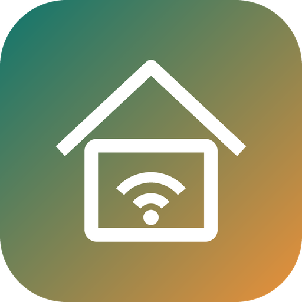

# Hawaii Local

Sign in with your **Smart Life / Tuya Smart** app once, and control your Tuya switches **over your home network**. You don't need a Tuya developer account, and you don't have to look up device IDs, keys or IP addresses.

## What it does

- **One sign-in.** Enter your Tuya **user code** and scan a QR code with the Tuya app. Your devices are imported with their local keys.
- **Local control with instant updates.** Each device, or each gateway, keeps a persistent connection. Switching in the Tuya app or at the wall shows up in Home Assistant straight away.
- **Gateway sub-devices.** Zigbee and BLE modules behind a Tuya gateway are found and matched to their gateway automatically.
- **Broken cloud profiles handled.** If a device has more channels than Tuya's cloud profile lists, the extra channels are read from the device itself and get their own switches.
- **Automatic IP finding.** Devices are found from their own network broadcasts. When a device's IP changes, it's followed within seconds. If broadcasts can't reach Home Assistant (for example Docker without host networking), Hawaii Local scans your network and identifies each device by its key.
- **Reset and re-pair recovery.** When a device is reset or re-paired in the Tuya app (new key, sometimes a new ID), Hawaii Local notices the failed login, re-imports from your Tuya account and reconnects. Entity IDs, dashboards and automations stay the same, because devices are tracked by hardware rather than Tuya ID.
- **Works without internet.** Devices and keys are cached locally. The Tuya cloud is only a fallback for devices that can't be reached on your network.

Phase 1 covers **on/off data points**: switches, multi-gang switches, sockets, scene-switch relays and gateway sub-devices. Dimmers, curtains, sensors and locks come next.

## Install

1. **Settings → Marketplace → ⋮ → Add from link**: `https://github.com/sariyamon/ha-hawaii-local-integration`, category **Integration**. Install **Hawaii Local**, then restart Home Assistant.
2. **Settings → Devices & services → Add integration → Hawaii Local.**
3. Enter your **user code**, found in the Smart Life / Tuya Smart app under **Me → ⚙️ → Account and Security → User Code**.
4. Scan the QR code with the Tuya app, approve, and press **Submit**.

## Settings (Configure)

| Option | What it does |
|---|---|
| Re-import devices from my Tuya account | Picks up new, renamed or re-paired devices now (this also happens by itself every 6 hours, and straight away after a reset is detected) |
| Search my network for devices now | Runs the network scan immediately |
| Set a device's IP address or protocol | Fixes an IP or protocol for one device or gateway. Leave it empty for automatic, which is recommended |

Each switch shows a `connection` attribute: `local` or `cloud`.

## Tips

- **Docker installs:** host networking (`network_mode: host`) lets broadcasts through so IP changes are picked up in seconds. Without it, the network scan still finds devices, just less quickly.
- **Stable IPs:** a DHCP reservation for gateways in your router is still a good idea, though it isn't required.
- **Security:** commands stay on your network, encrypted with each device's local key. Downloaded diagnostics have keys and tokens removed.

## License

MIT
