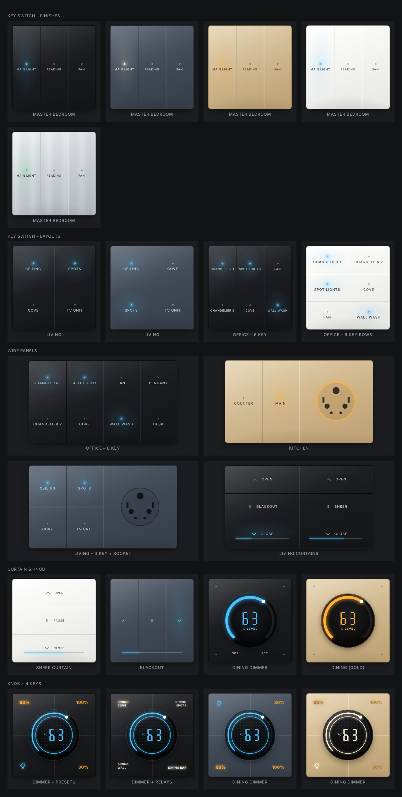

# Hawaii Local

Sign in with your **Smart Life / Tuya Smart** app once, and control your Tuya switches **over your home network**. You don't need a Tuya developer account, and you don't have to look up device IDs, keys or IP addresses.


## What it does

- **One sign-in.** Enter your Tuya **user code** and scan a QR code with the Tuya app. Your devices are imported with their local keys.
- **Local control with instant updates.** Each device, or each gateway, keeps a persistent connection. Switching in the Tuya app or at the wall shows up in Home Assistant straight away.
- **Gateway sub-devices.** Zigbee and BLE modules behind a Tuya gateway are found and matched to their gateway automatically.
- **Broken cloud profiles handled.** If a device has more channels than Tuya's cloud profile lists, the extra channels are read from the device itself and get their own switches.
- **Curtains and dimmers.** Curtain switches become curtains (open, stop, close, position) and dimmer switches become dimmable lights.
- **Wall-switch cards.** Ready-made dashboard cards that look like Hawaii Automations switches (see [Cards](#cards)).
- **Automatic IP finding.** Devices are found from their own network broadcasts. When a device's IP changes, it's followed within seconds. If broadcasts can't reach Home Assistant (for example Docker without host networking), Hawaii Local scans your network and identifies each device by its key.
- **Reset and re-pair recovery.** When a device is reset or re-paired in the Tuya app (new key, sometimes a new ID), Hawaii Local notices the failed login, re-imports from your Tuya account and reconnects. Entity IDs, dashboards and automations stay the same, because devices are tracked by hardware rather than Tuya ID.
- **Works without internet.** Devices and keys are cached locally. The Tuya cloud is only a fallback for devices that can't be reached on your network.

Covers switches, multi-gang switches, sockets, scene-switch relays, gateway sub-devices, curtain switches and dimmers. Sensors and locks come next.

## Install

1. **Settings → Marketplace → ⋮ → Add from link**: `https://github.com/sariyamon/ha-hawaii-local-integration`, category **Integration**. Install **Hawaii Local**, then restart Home Assistant.
2. **Settings → Devices & services → Add integration → Hawaii Local.**
3. Enter your **user code**, found in the Smart Life / Tuya Smart app under **Me → ⚙️ → Account and Security → User Code**.
4. Scan the QR code with the Tuya app, approve, and press **Submit**.

## Settings (Configure)

| Option | What it does |
|---|---|
| Re-import devices from my Tuya account | Picks up new, renamed or re-paired devices now (this also happens by itself every 6 hours, and straight away after a reset is detected) |
| Search my network for devices now | Runs the network scan immediately |
| Set a device's IP address or protocol | Fixes an IP or protocol for one device or gateway. Leave it empty for automatic, which is recommended |

Each switch shows a `connection` attribute: `local` or `cloud`.

## Cards

Hawaii Local adds switch cards that look like Hawaii Automations wall switches. They load by themselves (no resource to add): edit a dashboard → **Add card** → search **Hawaii**. Pick **any one entity** of a switch and the card shows the whole switch – every key with its name and indicator light. Tap a key to switch it, hold it for details.

| Card | What it shows |
| --- | --- |
| `custom:hawaii-key-switch-card` | 1–12 keys: columns, rows or grid; 2, 4 or 8 module size picked automatically |
| `custom:hawaii-key-socket-card` | Keys + universal socket (4 module); the socket can be a smart socket |
| `custom:hawaii-curtain-switch-card` | Open / pause / close with position bar; one or two curtains |
| `custom:hawaii-knob-dimmer-card` | Rotary dimmer with round level display – drag the ring, scroll, or tap the centre; optional Sc1 / Sc2 scene keys |
| `custom:hawaii-knob-keys-card` | Rotary dimmer ringed by four keys |

Finishes: black glass, aluminium grey, champagne gold, white glass, brushed silver. Indicator lights: ice blue, warm white, amber, green.

```yaml
type: custom:hawaii-key-switch-card
entity: switch.office_chandelier_1   # any one key – the whole switch is shown
layout: columns                      # auto | columns | rows | grid
finish: black                        # black | grey | gold | white | silver
indicator: blue                      # blue | white | amber | green
exclude: [switch.office_channel_119] # hide keys you don't use
```

The cards work with any switch, light, curtain or fan in Home Assistant, not only Hawaii Local devices.



## Tips

- **Docker installs:** host networking (`network_mode: host`) lets broadcasts through so IP changes are picked up in seconds. Without it, Home Assistant only sees Docker's own network, so Hawaii Local also searches the usual home-router networks (192.168.0.x, 192.168.1.x, 192.168.29.x and others). If your devices are on a different network, add it under **Configure → Choose which networks to search** (for example `192.168.5.0/24`).
- **Gateways:** multi-mode gateways that the Tuya app lists as sub-devices are still connected to directly, and their Zigbee / Bluetooth devices are shown "connected via" the gateway. Gateway reset switches are never created.
- **Stable IPs:** a DHCP reservation for gateways in your router is still a good idea, though it isn't required.
- **Security:** commands stay on your network, encrypted with each device's local key. Downloaded diagnostics have keys and tokens removed.

## License

MIT
